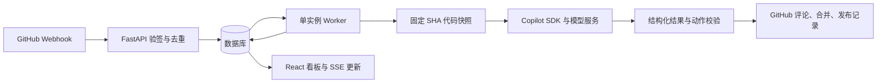

# Flowdeck 架构与代码导航

## 事件到任务

Webhook 请求先验签、确认仓库和去重，持久化后返回。Worker 独立消费事件、同步缺失记录并推进任务，避免让 GitHub 请求等待模型处理。项目需通过目录、GitHub API 和有效 ping 验证后激活。

每个分析任务使用固定提交的 `code/`、`base/`、差异和提交记录。模型经本地 Copilot runtime 读取工作区，返回结构化结果。Flowdeck 校验返回结果和项目策略，再由自己的 GitHub 客户端执行允许的动作；Agent 不持有 GitHub Token。任务状态、租约和会话标识用于失败或重启恢复。

## 代码导航

| 路径 | 职责 |
| --- | --- |
| `backend/main.py`、`backend/auth.py` | API、事件入口、看板读取、会话与管理员认证 |
| `backend/projects.py`、`backend/storage.py` | 项目接入、准备状态、存储归属和允许目录 |
| `backend/worker.py`、`backend/service.py` | 后台处理、任务推进、状态与时间线 |
| `backend/db.py`、`backend/schemas.py`、`backend/config.py` | 数据表、输入输出校验、环境与项目配置 |
| `backend/copilot_runtime.py`、`backend/agent_tasks.py`、`backend/agent_actions.py` | 模型会话、文件权限、事件任务与动作请求 |
| `backend/workspace.py`、`backend/github.py` | Git 缓存、SHA 快照、GitHub API |
| `backend/integrations.py`、`backend/credentials.py`、`backend/dingtalk.py` | 模型与通知配置、凭据加密、钉钉通知 |
| `backend/skills.py`、`backend/release_prepare.py` | 技能包管理与准备发布任务 |
| `backend/cli.py` | 管理员初始化、配置检查、同步、恢复和清理 |
| `frontend/src/` | React 中文界面、API 交互与记录详情 |
| `tests/` | API、Worker、工作区、恢复与浏览器验收 |
| `scripts/`、`deploy/` | Compose 辅助、事件上报和反向代理示例 |
| `releasing-version-docs/` | 可上传的发布文档技能示例 |

## 数据与进程

- 本地 demo 使用 SQLite，默认不运行 Worker；真实部署使用 PostgreSQL，API 与 Worker 共用数据库和数据目录。
- Compose 的 `prepare-data` 负责创建数据子目录和设置属主；`api` 提供 HTTP 与前端静态文件；`worker` 推进任务；`db` 保存业务数据。
- 当前只支持一个 Worker 实例。生产数据根目录由 `HOST_DATA_ROOT` 指定，包含 PostgreSQL 数据、项目 Git 缓存、任务工作区、技能包和 Agent 会话。
- 项目凭据和模型密钥经 `SECRETS_ENCRYPTION_KEY` 加密保存。备份、权限和恢复要求见 [README](../README.md) 与 [SECURITY.md](../SECURITY.md)。

## 扩展与验证

修改任务行为时，同时检查事件输入、数据库状态、Worker 恢复路径及外部动作的幂等性。权限检查不能只依赖 prompt，应在服务端和工具权限处理中落实。新增配置同时更新 `.env.example` 或项目示例，并给出兼容旧数据的处理方式。

`docs/superpowers/` 保存历史设计与实现计划，包含已替换方案，仅供理解演进过程。当前使用方式以 README、代码和测试为准。
